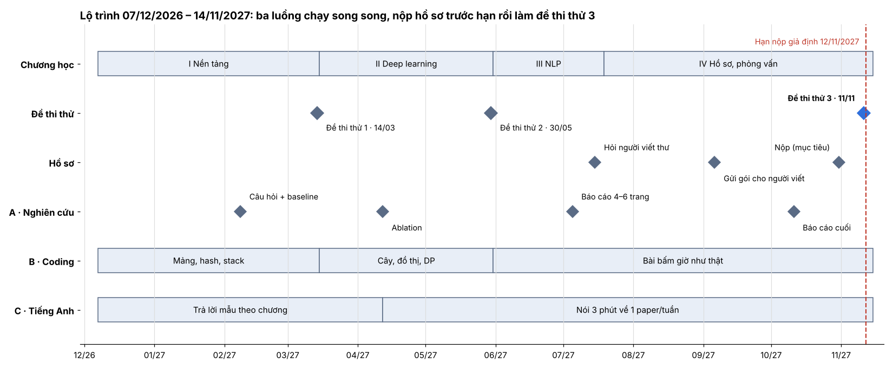

# Sổ tay luyện thi AI Residency — Track Research (NLP)

App học tập chạy trên máy của bạn, gom vào một chỗ: sách (chương 0–14 và ba đề thi thử), nhiệm vụ từng tuần, lab code, minh họa Manim và flashcard.



## Đọc sách trên web

Sách (chương 0–14, ba đề thi thử và video Manim của từng mục) có bản web tại **https://phucduong09.github.io/ai-residency-book/**. Mở bằng trình duyệt trên máy tính hay điện thoại, không cần cài gì và không cần terminal. Có mục lục, tìm kiếm, chế độ tối, công thức hiển thị bằng KaTeX.

- Trang tự dựng lại mỗi khi có commit vào `main` (kể cả khi merge PR rà soát hằng tháng), sau khoảng 1–2 phút. Workflow nằm ở `.github/workflows/web.yml`.
- Bản web chỉ để đọc. Tích tiến độ, flashcard và sửa lab vẫn dùng app trên máy.
- Xem thử trên máy: `pip install -r web/requirements.txt`, rồi `python web/build_docs.py` và `mkdocs serve`.
- `web/build_docs.py` không sửa `book/`: nó chép nội dung sang `web/_docs/`, chèn video Manim ngay dưới tiêu đề mục tương ứng (theo `manim/catalog.yaml`), rồi MkDocs dựng ra `web/_site/`.

## Lịch học

Lộ trình gồm 49 tuần (tuần 0 đến tuần 48), bắt đầu **Thứ Hai 7/12/2026** và kết thúc **14/11/2027**. Mỗi tuần khoảng 12–15 giờ, chia cho chương học và ba luồng chạy song song: A (dự án nghiên cứu), B (coding), C (tiếng Anh và trình bày). Nhiệm vụ chi tiết nằm trong `plan/weeks.yaml`.

| Giai đoạn | Tuần | Thời gian | Nội dung |
| --- | --- | --- | --- |
| Phần I — Nền tảng | 0–12 | 7/12/2026 – 7/3/2027 | Chương 0–6 |
| Đề thi thử 1 | 13 | làm ngày 14/3/2027 | Chương 1–6, 120 phút |
| Phần II — Deep learning hiện đại | 14–23 | 15/3 – 23/5/2027 | Chương 7–11 |
| Đề thi thử 2 | 24 | làm ngày 30/5/2027 | Chương 7–11 và nhắc lại Phần I |
| Phần III — Chuyên sâu NLP | 25–31 | 31/5 – 18/7/2027 | Chương 12 (tuần 25–28), ba tuần đệm cho dự án (29–31) |
| Phần IV — Hồ sơ và phỏng vấn | 32–47 | 19/7 – 7/11/2027 | Chương 13 (32–34), chương 14 (35–38), ôn điểm yếu (39–44), hồ sơ (45–47) |
| Đề thi thử 3 | 48 | 11/11 và 13/11/2027 | Mô phỏng đủ các vòng sau khi nộp hồ sơ |

**Mốc hồ sơ.** Các mốc này bám theo hạn nộp **giả định** 12/11/2027 (suy từ đợt tuyển trước, chưa xác minh), không phải theo lịch học:

- Trước 15/7/2027 (tuần 31): hỏi hai người viết thư giới thiệu.
- Tuần 39 (6–12/9/2027): gửi gói tài liệu cho người viết thư.
- 22/10 và 5/11/2027: nhắc người viết thư.
- Trước 31/10/2027 (tuần 46): nộp hồ sơ. Muộn nhất là tuần 47.

Khi trang tuyển dụng chính thức công bố hạn thật, hãy sửa các mốc này theo hạn thật.

**Việc từng ngày.** Mỗi việc trong `plan/weeks.yaml` có trường `days` ghi nó làm vào thứ mấy và bao nhiêu giờ (1 = Thứ Hai, 7 = Chủ nhật). Thứ Hai đến Thứ Bảy chia đều giờ của tuần, khoảng 2–2.5 giờ mỗi ngày; Chủ nhật để nghỉ hoặc làm bù, trừ ngày có đề thi thử. Việc của chương giữ thứ tự đọc → bài tập → lab → mini-test; việc dài được chia thành nhiều buổi. Bản đọc được nằm ở [`plan/lich-theo-ngay.md`](plan/lich-theo-ngay.md). Sửa việc trong `weeks.yaml` xong thì chạy `python plan/chia_ngay.py` để chia lại.

**App dùng ngày thế nào.** Trang **Tuần này** tự chọn tuần chứa ngày hôm nay và mở sẵn mục của hôm nay. Chọn "Xem theo: Ngày" để tích từng buổi, hoặc "Luồng" để xem theo chương và luồng A, B, C như trước. Trước 7/12/2026, app hiện tuần 0. Ô đếm ngược lấy ngày đề thi thử từ `book/chapters.yaml`.

**Muốn dời lịch lần nữa:**

1. Đổi các dòng `start:` trong `plan/weeks.yaml` và ngày `mock_tests` trong `book/chapters.yaml`.
2. Chạy `python plan/ve_lo_trinh.py` để vẽ lại hình lộ trình.
3. Tìm và sửa ngày ghi trong chữ ở `book/chuong-00.md`, `book/huong-dan.md` và ba file `book/thi-thu-*.md`.

## Cài đặt (một lần)

1. Nhấp đúp `setup.bat`. Script dùng Anaconda có sẵn trên máy để tạo môi trường `residency-book` (Python 3.11, NumPy, JupyterLab, Streamlit, Manim, ffmpeg, PyTorch bản CPU cho lab chương 6–12). Lần đầu mất khoảng 5–15 phút. Cuối cùng script in phiên bản PyTorch để bạn biết đã cài được.
2. **Đã chạy `setup.bat` từ trước?** Chạy lại một lần: script cập nhật môi trường cũ và cài thêm PyTorch. Nếu vẫn báo chưa import được PyTorch, mở **Anaconda Prompt** rồi chạy:

   ```
   conda activate residency-book
   pip install torch --index-url https://download.pytorch.org/whl/cpu
   ```

   Muốn dùng GPU thì lấy lệnh cài bản CUDA hợp với card của bạn ở pytorch.org.
3. Mở app theo một trong hai cách ở mục dưới.

Nếu `setup.bat` báo không tìm thấy conda: mở **Anaconda Prompt**, `cd` vào thư mục này rồi chạy `conda env create -f environment.yml`, sau đó `conda activate residency-book` và `streamlit run app/app.py`.

## Mở app

**Cách thường dùng (một cú nhấp).** Làm một lần: nhấp đúp `tao_shortcut.bat`. Biểu tượng **Residency Book** xuất hiện trên Desktop; từ đó chỉ cần nhấp đúp biểu tượng này. App mở trong cửa sổ riêng (không thanh địa chỉ, không tab), không hiện cửa sổ dòng lệnh, và đóng cửa sổ là server tự tắt.

- Cần Microsoft Edge hoặc Google Chrome (Windows có sẵn Edge). Nếu không có, app mở bằng trình duyệt mặc định và server vẫn chạy nền: khi đó dùng `run_app.bat`.
- App dùng cổng cố định 8765.
- Muốn ghim lên thanh tác vụ hoặc menu Start: chuột phải biểu tượng trên Desktop → Pin to taskbar / Pin to Start.

**Cách dự phòng.** Nhấp đúp `run_app.bat`, rồi tự mở trình duyệt tới `http://localhost:8501` (app chạy ở chế độ không tự mở trình duyệt). Cửa sổ dòng lệnh hiện thông báo lỗi nếu có. Dùng cách này khi app không khởi động được.

**Sửa code ngay trong app.** Ở trang **Lab**, nút "Mở và sửa code ngay trong app" nhúng JupyterLab vào cửa sổ app: bạn sửa các ô `# TODO`, bấm Shift+Enter để chạy và Ctrl+S để lưu thẳng vào file trong `labs/`. JupyterLab chỉ nghe ở `127.0.0.1` (cổng 8866, có token ngẫu nhiên mỗi lần mở app) và tự tắt khi đóng app. Nếu cổng 8866 bị chiếm, app báo lỗi ngay tại trang Lab.

## Cập nhật từ GitHub

Nếu thư mục này là bản clone của repo, chạy `git pull` để lấy bản mới. Tiến độ của bạn nằm trong `progress/`, thư mục này không được đưa lên git, nên cập nhật không xóa tiến độ.

## Cấu trúc thư mục

| Đường dẫn | Nội dung |
| --- | --- |
| `app/app.py` | App Streamlit, gồm các trang Tuần này, Sách, Lab, Manim, Ôn tập, Tiến độ |
| `book/` | Nội dung sách (Markdown kiểu MyST): `huong-dan.md`, `chuong-00.md` đến `chuong-14.md`, `thi-thu-1.md` đến `thi-thu-3.md`. `chapters.yaml` là danh mục chương và ngày đề thi thử |
| `labs/chuongXX/` | `lab.ipynb` (bản có TODO và ô kiểm tra tự động), `loigiai.ipynb` (bản lời giải đã chạy kiểm) |
| `labs/thi-thu-N/` | File khung `bai_lam_mau.py` và bộ chấm phần lập trình (`cham_phan_c.py` cho đề 1–2, `cham_coding.py` cho đề 3). Đề 3 có thêm `nguoi-phong-van.md`: đưa cho người phỏng vấn, bạn chỉ mở sau buổi 2 |
| `manim/` | Code các cảnh (`chuongXX_scenes.py`), video render sẵn (`videos/`), danh mục (`catalog.yaml`), lời giải bài dựng cảnh (`loigiai/`), cảnh của bạn (`cua-toi/`) |
| `plan/weeks.yaml` | Nhiệm vụ từng tuần, chia theo chương học và luồng A, B, C |
| `plan/ve_lo_trinh.py` | Vẽ lại `plan/lo-trinh.png` từ lịch hiện tại |
| `plan/chia_ngay.py` | Chia việc mỗi tuần ra từng ngày (trường `days`) và sinh `plan/lich-theo-ngay.md` |
| `web/`, `mkdocs.yml` | Dựng bản web của sách (MkDocs Material, KaTeX để sẵn trong `web/extra/katex/`) |
| `flashcards/` | Thẻ ôn tập dạng CSV cho chương 1–14 (nhập được vào Anki) |
| `progress/progress.json` | Tiến độ của bạn: việc đã xong, lịch ôn thẻ, điểm mini-test (app tự tạo, không đưa lên git) |

## Ghi chú

- **Manim trên Windows:** các cảnh dùng font Segoe UI khi render trên Windows. Nếu một ký hiệu (ví dụ ᵀ) hiện thành ô vuông, đổi biến `FONT` ở đầu file cảnh sang `"Cambria Math"`. Video trong `manim/videos/` đã được render sẵn nên app chạy được ngay cả khi chưa render lại.
- **Giọng đọc cho video Manim:** `manim/giong_doc.py` mặc định dùng giọng nam NamMinh của Microsoft Edge TTS (gói `edge-tts`, `setup.bat` tự cài; miễn phí, không cần API key). Đặt `MANIM_GIONG=gtts` để dùng giọng nữ của Google Translate (gói `gtts`). Mọi cảnh có nền lưới mờ nhờ `manim/nen.py`. Trong cảnh, bọc từng đoạn hình bằng `with noi(self, "câu thoại"):`; cảnh tự kéo dài cho khớp câu đọc. Hiện mới có lời thoại cho `GradientDongMuc` và `FanOutCongDon` (chương 2). Render lại (lần đầu cần Internet, mp3 được lưu ở `manim/giong_doc_cache/`):
  ```
  cd manim
  manim -qm chuong02_scenes.py GradientDongMuc FanOutCongDon
  ```
  rồi chép hai file mp4 trong `manim/media/videos/chuong02_scenes/720p30/` vào `manim/videos/chuong02/`. Đặt `MANIM_KHONG_GIONG=1` để render câm như cũ.
- **Công thức** trong sách hiển thị bằng KaTeX của Streamlit; ký hiệu trong câu chữ dùng Unicode (Aᵀ, ‖x‖₂, ℝⁿ).
- **Chưa thử trên Windows thật:** `setup.bat`, các script mở app và các bộ chấm mới chỉ chạy thử trên Linux. Nếu gặp lỗi, chạy `run_app.bat` để xem thông báo.
- **Giả định cần xác nhận:** ngành học 4 năm, hạn nộp 12/11/2027, các ngưỡng điểm và thời gian làm đề đều là ước lượng của sách, chưa kiểm trên người làm thật.
