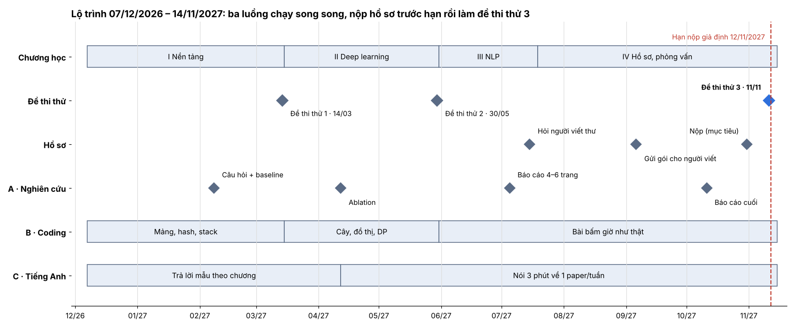

# Sổ tay luyện thi AI Residency — Track Research (NLP)

## Cách dùng sách và app

Đây là sách luyện tập, không phải sách đọc: bạn chỉ thật sự hiểu một chương khi tự làm được bài tập và trả lời được chuỗi câu hỏi phỏng vấn của chương đó. Mục tiêu là đủ sức vượt qua các vòng tuyển của residency track Research (Qualcomm RRP, VinAI): entrance test, coding interview, video presentation và technical interview.

**Mỗi ngày mở app ở trang Tuần này.** Trang đó cho biết tuần này phải làm gì, ở luồng nào, mất khoảng bao nhiêu giờ. Đánh dấu việc nào xong thì tick ngay. Các trang còn lại:

| Trang | Dùng để làm gì |
| --- | --- |
| Tuần này | Nhiệm vụ của tuần, chia theo chương học và ba luồng A, B, C |
| Sách | Đọc hướng dẫn và từng chương; video Manim hiện ngay trong mục liên quan; lời giải được giấu sau nút bấm |
| Lab | Mở notebook trong JupyterLab: bản có TODO để tự viết, bản lời giải để đối chiếu |
| Manim | Xem các cảnh minh họa, xem code, render lại, render cảnh do bạn tự viết |
| Ôn tập | Flashcard tự lên lịch theo hộp Leitner |
| Tiến độ | Giờ đã học theo tuần, điểm mini-test, việc còn tồn |

**Mỗi chương có cùng một khung:**

1. **Kiểm tra nhanh đầu chương** — 5 câu, câu i ứng với mục i. Đúng câu nào thì đọc lướt mục đó.
2. **Lý thuyết cô đọng** — trực giác trước, công thức sau, mỗi mục kèm ví dụ giải mẫu, video Manim và hộp "Vì sao ML cần cái này".
3. **Bài tập giấy bút** — ★ hiểu định nghĩa, ★★ mức đề thi đầu vào, ★★★ mức phỏng vấn nghiên cứu.
4. **Bài tính nhanh** — 15 bài bấm giờ để luyện tốc độ tính tay.
5. **Lab code** — notebook có ô kiểm tra tự động, kèm một bài "săn bug".
6. **Bài dựng cảnh Manim** — tự vẽ một khái niệm, giới hạn 1 giờ.
7. **Chuỗi câu hỏi phỏng vấn** — mỗi chuỗi đào 4 tầng "tại sao", kèm câu trả lời mẫu bằng tiếng Anh.
8. **Bẫy thường gặp** và **Thực tế khác lý thuyết**.
9. **Mini-test 30 phút** — có thang điểm và ngưỡng để quyết định sang chương sau hay ôn lại.
10. **Flashcard** và **Lời giải** cuối chương. Chỉ xem lời giải sau khi đã thử ít nhất 20 phút.

**Nhịp học mỗi tuần (khoảng 12–15 giờ):**

- Khoảng 8 giờ cho chương học; phần còn lại cho dự án nghiên cứu (luồng A), coding (luồng B) và tiếng Anh (luồng C).
- 2 khối học sâu 90 phút mỗi ngày trong tuần, điện thoại để ngoài tầm tay.
- Thứ Bảy: làm bài ★★★ và lab. Chủ Nhật: ôn flashcard, review 15 phút (xong gì, trượt gì, vì sao).
- Ghi lỗi sai vào một file "sổ lỗi" riêng. Trước mỗi đề thi thử, đọc lại sổ lỗi.

**Quy ước ký hiệu.** Ký hiệu toán viết đúng dạng; công thức dài nằm trong khung công thức riêng. Số thập phân dùng dấu chấm (0.85) cho khớp với code, hàng nghìn ngăn bằng dấu cách (65 536).

| Ký hiệu | Nghĩa |
| --- | --- |
| x, y, v (chữ thường) | Vector cột |
| A, X, W (chữ hoa) | Ma trận |
| ℝⁿ, ℝᵐˣⁿ | Không gian vector n chiều; tập ma trận m hàng n cột |
| aⱼ, rᵢᵀ | Cột thứ j của A; hàng thứ i của A |
| Aᵢⱼ | Phần tử ở hàng i, cột j |
| Aᵀ, A⁻¹, A⁺ | Chuyển vị, nghịch đảo, giả nghịch đảo |
| xᵀy | Tích vô hướng của x và y |
| ‖x‖₂, ‖x‖₁, ‖x‖∞ | Chuẩn L2, L1, L∞ |
| ‖A‖₂ | Chuẩn phổ của ma trận, bằng σ₁ |
| C(A), N(A) | Không gian cột, không gian null |
| tr A, det A | Vết, định thức |
| λᵢ, σᵢ | Trị riêng, giá trị kỳ dị (σ₁ ≥ σ₂ ≥ …) |
| diag(d₁, …, dₙ) | Ma trận đường chéo |
| I, eⱼ | Ma trận đơn vị; vector đơn vị thứ j |
| κ(A) | Số điều kiện, bằng σ₁/σᵣ |

**Lưu ý trung thực:** đề entrance test của Qualcomm và VinAI không công khai. Mọi đề thi thử trong sách là đề mô phỏng, soạn dựa trên yêu cầu chính thức ("thành thạo lập trình và toán") và nội dung các khóa ML nền tảng của Stanford, MIT, CMU. Nội dung sách được viết lại, không chép từ giáo trình gốc; link nguồn nằm ở cuối mỗi chương.

## Đề cương toàn bộ sách

Sách gồm 14 chương lõi, 3 đề thi thử và 3 luồng việc chạy song song từ tuần đầu tiên, kéo dài từ 7/12/2026 đến giữa tháng 11/2027. Mốc nộp hồ sơ là đợt tuyển cuối năm 2027, với giả định ngành của bạn học 4 năm (cần xác nhận). Chương 0–13 đã có trong app; chương 14 và ba đề thi thử được bổ sung trước tuần cần dùng. Chương chưa viết hiện tên trong app nhưng chưa mở được.

**Phần I — Nền tảng (tháng 12/2026 – 3/2027, 12 tuần)**

0. Bài chẩn đoán đầu vào — 30 câu, chấm theo chương để biết nên học kỹ chương nào.
1. **Đại số tuyến tính cho ML** — ma trận là phép biến đổi, hạng, phép chiếu, QR, trị riêng, SVD, PCA.
2. Giải tích ma trận và backpropagation — gradient, Jacobian, quy tắc chuỗi dạng ma trận, đồ thị tính toán.
3. Xác suất, thống kê, lý thuyết thông tin — MLE/MAP, entropy, KL divergence, cross-entropy, khoảng tin cậy.
4. Tối ưu hóa — hàm lồi, gradient descent, SGD, momentum, Adam, điều kiện hội tụ.
5. ML cổ điển — hồi quy, phân loại, bias–variance, regularization, SVM và kernel, cây và boosting, k-means, GMM/EM.
6. Mạng nơ-ron từ con số 0 — MLP bằng NumPy rồi PyTorch, khởi tạo, normalization, cách debug khi loss không giảm.

→ **Đề thi thử 1** (14/3/2027, bấm giờ 120 phút).

**Phần II — Deep learning hiện đại (tháng 3 – 5/2027, 12 tuần)**

7. CNN và thị giác máy tính — convolution, ResNet, augmentation, ViT.
8. Attention và Transformer — RNN và vanishing gradient, self-attention, positional encoding, KV cache.
9. Mô hình ngôn ngữ lớn — pretraining, scaling laws, finetuning, LoRA, RLHF và DPO ở mức nguyên lý.
10. Mô hình sinh và học tự giám sát — VAE, diffusion, contrastive learning.
11. Phương pháp thực nghiệm và đọc paper — đánh giá đúng, ablation, nhiều seed, khoảng tin cậy; phiếu đọc 8 paper kinh điển.

→ **Đề thi thử 2** (30/5/2027, cuối tuần 24).

**Phần III — Chuyên sâu NLP (tháng 6 – 7/2027)**

12. Nhánh chuyên sâu và đạo đức AI: NLP, trọng tâm là LLM, retrieval (RAG) và trích xuất tri thức; đọc 10 paper gần đây của hướng này, nối thẳng với dự án ở luồng A; thêm một buổi về bias, quyền riêng tư và đánh giá rủi ro.

**Phần IV — Hồ sơ và phỏng vấn (tháng 7 – 11/2027)**

13. Hồ sơ và video presentation — CV, research statement, thư giới thiệu, kịch bản trình bày dự án bằng tiếng Anh, thang tự chấm.
14. Technical interview — ngân hàng chuỗi câu hỏi tổng hợp và câu hỏi hành vi, luyện bằng tiếng Anh.

→ **Đề thi thử 3** (11/11/2027, sau khi nộp hồ sơ, mô phỏng đủ các vòng).

**Ba luồng chạy song song suốt kế hoạch.** Dự án nghiên cứu và coding không phải một chương học một lần, mà là việc làm đều mỗi tuần.

- **Luồng A — Dự án nghiên cứu (3–4 giờ/tuần).** Lấy một dự án đang làm trên trường làm nền, nâng lên mức nghiên cứu: câu hỏi rõ, baseline, ablation, báo cáo. Đây là tín hiệu mạnh nhất của hồ sơ track Research và là nguồn thư giới thiệu.
- **Luồng B — Coding (3–4 bài/tuần).** Đi từ mảng, hash, hai con trỏ, stack sang cây, đồ thị, quy hoạch động, cuối cùng là bài bấm giờ như phỏng vấn thật.
- **Luồng C — Tiếng Anh và trình bày (1 giờ/tuần).** Mỗi chương có câu trả lời mẫu bằng tiếng Anh và một bài dựng cảnh Manim. Từ tháng 4/2027, mỗi tuần nói 3 phút về một paper, ghi âm và tự nghe lại.

Đọc theo cột: tháng nào bạn cũng làm cả bốn việc — học chương, dự án, coding, tiếng Anh. Mốc của dự án nghiên cứu được đặt trùng hoặc ngay trước đề thi thử để mỗi đợt kiểm tra cũng là một lần rà lại hồ sơ.
